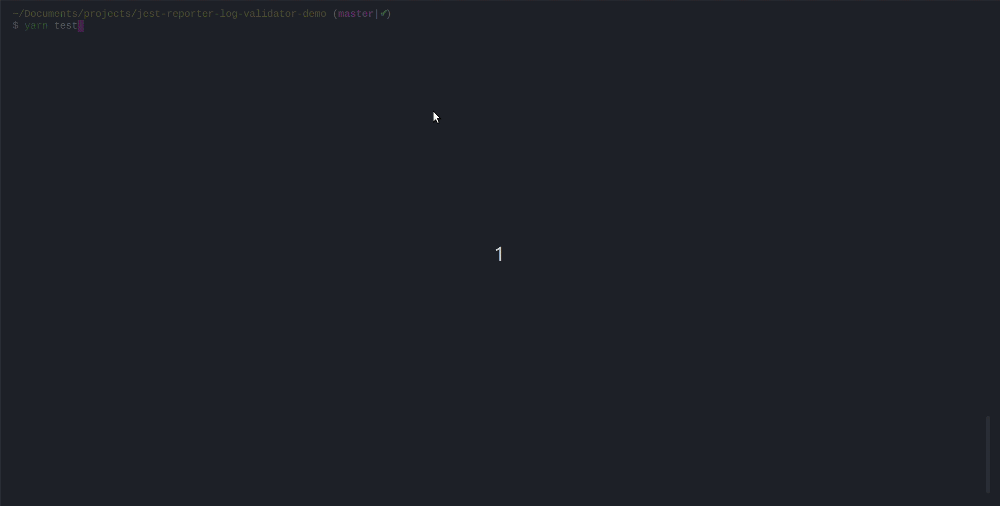

<h1 align="center">
  <br>jest-reporter-log-validator ⚠️
  <br>
</h1>

<h4 align="center">Make your tests fail when unwanted log, warning, or error messages are found.</h4>

<p align="center">
  <a href="https://www.npmjs.com/package/jest-reporter-log-validator">
    
  </a>
  <a href="./LICENSE">
    
  </a>
</p>



## What this project solves

Warning messages generated by tests can quickly accumulate, causing bugs for users and a poor
development experience. This reporter lets you set limits on console messages based on string
patterns, so new warnings are caught before they are merged.

> A "log message" is anything a test writes through the `console` object, such as `console.log`,
> `console.warn`, or `console.error`.

## Requirements and compatibility

- Node.js `>=18.14.0`
- Jest `>=26 <31`

Tested against Jest:

| Jest version | Supported |
| --- | --- |
| 26.6.3 | ✅ |
| 27.5.1 | ✅ |
| 28.1.3 | ✅ |
| 29.7.0 | ✅ |
| 30.5.2 | ✅ |

Jest 26 through 29 do not expose console output to custom reporters when `verbose` is enabled.
With those versions, set `verbose: false` if you want log validation to run. Jest 30 does expose
console output in verbose mode, so validation runs there as well.

Note that Jest automatically enables `verbose` when a run contains exactly one test file. If you
run a single file on Jest 26–29, set `verbose: false` explicitly.

## Installation

```bash
npm install --save-dev jest-reporter-log-validator
# or
pnpm add --save-dev jest-reporter-log-validator
# or
yarn add --dev jest-reporter-log-validator
```

## How it works

The reporter collects the console messages from every test file through Jest's
`onTestResult` hook. After the run, it compares those messages against your configuration and
returns an error if any validation fails. Jest then exits with a non-zero status code.

Key behavior:

- Messages are counted across the whole test run, not per test file.
- Patterns are case-sensitive substring matches using `String.includes`.
- Every pattern in a validation must be present in the message for it to count (AND behavior).
- One message can match more than one validation.
- `max` is inclusive: `max: 0` means the message must never appear.
- Identical unknown messages are reported only once.

## Setup

Add the reporter to `jest.config.js`:

```js
/** @type {import('jest').Config} */
module.exports = {
  reporters: [
    "default",
    "jest-reporter-log-validator",
  ],
}
```

If you need configuration inline:

```js
/** @type {import('jest').Config} */
module.exports = {
  reporters: [
    "default",
    [
      "jest-reporter-log-validator",
      {
        logValidations: [
          { patterns: ["Warning: You cannot change <Router history>"], max: 4 },
        ],
        failIfUnknownLogsFound: true,
        failIfLogValidationsOutdated: true,
      },
    ],
  ],
}
```

You can also use a `jest.config.json` or a `jest` key in `package.json` if that fits your project.

## Configuration

| Option | Type | Description | Default |
| --- | --- | --- | --- |
| `logValidations` | `Array<{ patterns: string[], max: number }>` | Limits how many times a matching message may appear. All patterns in one item must match. | `[]` |
| `failIfLogValidationsOutdated` | `boolean` | Fails when the configured `max` is higher than the number of messages that actually appeared. | `true` |
| `failIfUnknownLogsFound` | `boolean` | Fails when a message matches neither `logValidations` nor `exemptLogs`. | `false` |
| `exemptLogs` | `Array<{ patterns: string[] }>` | Messages that may appear any number of times and are ignored by `failIfUnknownLogsFound`. | `[]` |

Complete example:

```js
/** @type {import('jest').Config} */
module.exports = {
  reporters: [
    "default",
    [
      "jest-reporter-log-validator",
      {
        logValidations: [
          { patterns: ["Warning: You cannot change <Router history>"], max: 4 },
          {
            patterns: ["Warning: An update to", "inside a test was not wrapped in act(...)."],
            max: 20,
          },
        ],
        exemptLogs: [
          {
            patterns: [
              "Warning: A component is changing an uncontrolled input of type text to be controlled",
            ],
          },
        ],
        failIfUnknownLogsFound: false,
        failIfLogValidationsOutdated: true,
      },
    ],
  ],
}
```

### Configuration file

Create `.jest-reporter-log-validator-config.json` in the current working directory, which is
usually your project root:

```json
{
  "logValidations": [
    {
      "patterns": ["Warning: You cannot change <Router history>"],
      "max": 4
    }
  ],
  "exemptLogs": [
    {
      "patterns": ["Warning: A component is changing an uncontrolled input of type text to be controlled"]
    }
  ],
  "failIfUnknownLogsFound": false,
  "failIfLogValidationsOutdated": true
}
```

### Package.json configuration

```json
{
  "name": "my-project",
  "version": "1.0.0",
  "jest-reporter-log-validator": {
    "logValidations": [
      {
        "patterns": ["warning defined in package.json"],
        "max": 1
      }
    ]
  }
}
```

### Precedence and merging

Configuration sources are applied in this order, from highest to lowest priority:

1. `.jest-reporter-log-validator-config.json`
2. Reporter options in the Jest config
3. The `jest-reporter-log-validator` key in `package.json`
4. Default values

Configuration is shallow-merged with `Object.assign`. Arrays are replaced, not concatenated.
For example, a `logValidations` array in the config file replaces the entire `logValidations`
array from the Jest config.

## Recipes

### Existing project with many warnings

Add known warnings to `logValidations` when the count is stable. Use `exemptLogs` for warnings
that appear a variable number of times or that you cannot fix yet.

```js
{
  logValidations: [
    { patterns: ["Warning: You cannot change <Router history>"], max: 4 },
    {
      patterns: ["Warning: An update to", "inside a test was not wrapped in act(...)."],
      max: 20,
    },
  ],
  exemptLogs: [
    { patterns: ["Warning: A component is changing an uncontrolled input of type text to be controlled"] },
    { patterns: ["Deprecation warning: value provided is not in a recognized RFC2822 or ISO format"] },
  ],
  failIfUnknownLogsFound: true,
  failIfLogValidationsOutdated: true,
}
```

### New project with strict logging

Start strict from day one:

```js
{
  failIfUnknownLogsFound: true,
  failIfLogValidationsOutdated: true,
}
```

### A handful of widespread warnings

Track the known warnings and prevent new ones from appearing:

```js
{
  logValidations: [
    { patterns: ["Warning: You cannot change <Router history>"], max: 4 },
    {
      patterns: ["Warning: An update to", "inside a test was not wrapped in act(...)."],
      max: 20,
    },
  ],
  failIfLogValidationsOutdated: true,
}
```

## Troubleshooting

### Validation does not run in verbose mode

On Jest 26–29, custom reporters do not receive console output in verbose mode. Set
`verbose: false`. Jest 30 does not have this limitation.

Jest also enables verbose mode automatically when there is only one test file. If validation
seems to be skipped on Jest 26–29, check whether `verbose` is set to `false` explicitly.

### The config file is ignored

The reporter reads `.jest-reporter-log-validator-config.json` from `process.cwd()`. In a
monorepo, run Jest from the package directory that contains the config file, or pass the options
directly in the Jest config.

### `failIfLogValidationsOutdated` fails unexpectedly

This option requires the actual message count to equal `max`. If a warning disappears, lower the
configured `max` to the new count, or set `failIfLogValidationsOutdated: false`.

### A log message is not detected

Only calls to the captured `console` methods are visible. Direct writes to `process.stdout` or
`process.stderr` are not collected. Patterns are also case-sensitive substring matches, not
regular expressions.

## Development

```bash
pnpm install
pnpm test
pnpm check
```

Use `pnpm format` to format the code with Biome. Releases are managed with release-please.

## Contributing

See [CONTRIBUTING.md](./CONTRIBUTING.md).

## License

[MIT](./LICENSE)
